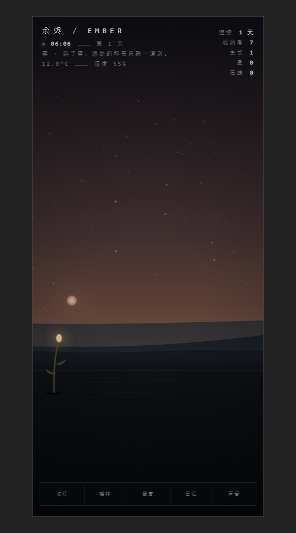

# 余烬 · EMBER

> 一个常驻服务器的小世界。它不等你 —— 你不在的时候，它照样天亮、下雨、长东西、枯掉。



不是监控面板，也不是待办清单。是一个**在服务器上自己活着**的小场景：天会亮会黑，
土里会长东西，会有访客点灯、播种、留一句话。你回来的时候，它会告诉你你错过了什么。

零依赖：只用 Node 标准库 + 原生 Canvas，没有 npm 包、没有 CDN、没有外部字体，
页面里没有一张位图，所有图形运行时生成。

---

## 它怎么跑

```
浏览器 ──SSE──┐
              ├─►  Node (标准库 http)  ──►  data/world.json
浏览器 ──REST──┘        │                  data/chronicle.jsonl
                        └─ 每 5 秒推进一次世界
```

**世界在服务端推进，和有没有人打开页面无关。** 进程挂了会按停机时长补算世界时间
（最多补 7 天），并写一条「观测中断」。

- 1 个世界日 = 6 小时真实时间
- 太阳和月亮沿弧线走，天光按时刻连续变化
- 天气：晴 / 雨 / 雾 / 极光 / 静。**极光由真实 CPU 负载触发**（负载 > 55% 且是夜里）

## 你能做的

| 动作 | 效果 |
|---|---|
| **点灯** | 照亮附近的植物，帮它们生长；灯会自己熄灭 |
| **播种** | 五个物种，各有生长速率、耗水量、光照需求和耐受力 |
| **留言** | 变成天上一颗星，永久挂着；同一个人的星会连成星座 |
| **存档** | 把此刻的世界离屏重绘成一张 1600×1000 的 PNG，带落款 |

植物缺水会掉健康，掉光就枯死。下雨会自动补水。

## 存档

按 `S` 或点底部「存档」，会把当前这一刻**重新绘制一遍**成 1600×1000 的 PNG
（不是截屏 —— 是换一块画布跑同一套绘制逻辑，所以清晰度和尺寸都独立于窗口）。
左下角落款：第几天、时刻、天气、最后一篇记录。

## 秘密

**无人花。** 连续 3 小时没有访客，土里会自己长出一株不在图鉴里的东西 ——
半透明的钟形帷幕，垂在空地上。点开它，它会说一段只属于那段空白时间的话。

有人回来，它就开始合上。

## 签到

每天第一次打开算一次签到，右上角显示连续天数。**每连续满 7 天，地里自动多一株
「守夜·N」**。断一天归 1。

## 数值平衡

一个世界日 = 1440 世界分钟 = 6 小时真实时间。

| 物种 | 长成所需（世界日） | 断水到枯死（约） |
|---|---|---|
| 苔 | ~3.9 | 更长（耐受力 1.8） |
| 蕨 | ~2.5 | ~10 天 |
| 灯芯花 | ~3.2 | ~8 天 |
| 藤 | ~1.9 | ~6 天 |
| 晶簇 | ~5.8 | 不需要水 |

也就是说：**离开一两天，大部分植物扛得住；离开一周，一定会失去一些东西。**
这是故意的。

---

## 本地运行

```bash
git clone git@github.com:MiLa11408/kaka.git
cd kaka
node server.js            # 默认 http://127.0.0.1:3600
```

没有依赖，不需要 `npm install`。数据落在 `data/`。

```bash
PORT=3600 DATA_DIR=./data node server.js
WORLD_SPEED=400 node server.js    # 加速 2000 倍，用来调试植物生命周期
SAVE_MS=1000 node server.js       # 加快落盘，方便测试
```

### 测试

```bash
npm test        # 等价于 node --test test/api.test.js
```

18 个集成用例：起一个真的服务器，用真的 HTTP 打它。覆盖播种 / 浇水 / 留言 / 点灯 /
签到 / 身份隔离 / 路径穿越 / CORS / 限流 / 无人花。

为了能测时间相关的东西，三个环境变量是可调的：

| 变量 | 默认 | 用途 |
|---|---|---|
| `TICK_MS` | 5000 | 模拟步长 |
| `WORLD_SPEED` | 0.0667 | 每真实秒推进多少世界分钟 |
| `SILENCE_MS` | 3 小时 | 无人花阈值 |

## 部署

```bash
pm2 start ecosystem.config.js
```

Nginx 反代示例见 `nginx-ember.conf`。SSE 必须 `proxy_buffering off`。

## 接口

```
GET  /api/state                  完整状态
GET  /api/stream                 SSE 推送（5s）
GET  /api/chronicle?limit=200    观测日志（倒序）
POST /api/visit                  记录到访，返回「你不在的时候」摘要 + 签到
POST /api/act  {type: light|plant|water|word|rename}
GET  /api/health                 无鉴权，供探活
```

身份是一个 `ember_uid` Cookie（也接受 `X-Ember-Uid` 请求头，给原生壳用）。
没有账号体系，只有「这台浏览器」。

限流：同 IP 10 分钟 40 次动作。

## 结构

```
server.js              世界模拟 + HTTP + SSE（无框架）
public/index.html      单文件前端（CSS/JS 内联，Canvas 2D）
public/sw.js           Service Worker：离线看上一次的世界
public/manifest.webmanifest
icon.html              图标的 SVG 源，用浏览器截图导出各尺寸 PNG
nginx-ember.conf       反代示例
```

## 已知取舍

- 天气每小时掷一次骰子，不是模拟出来的气压场
- 日记文本是规则 + 随机组合生成的，不是语言模型。它读起来像人，但它只会说它见过的事
- 进程级「负载」用 `os.cpus()` 的时间差算，只影响极光触发，不需要精确
- 世界时间按停机时长补算，所以长时间断电后回来，会看到一片旱死的植物和一条「观测中断」

## 许可

MIT
